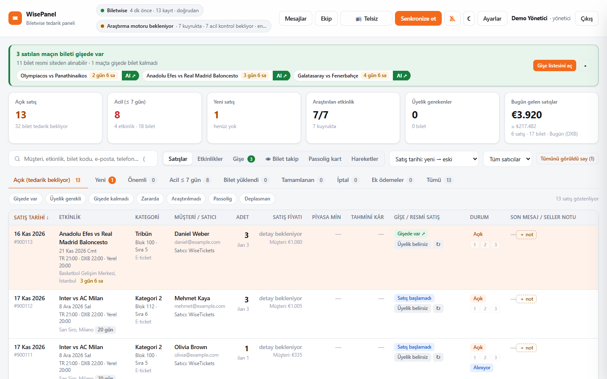
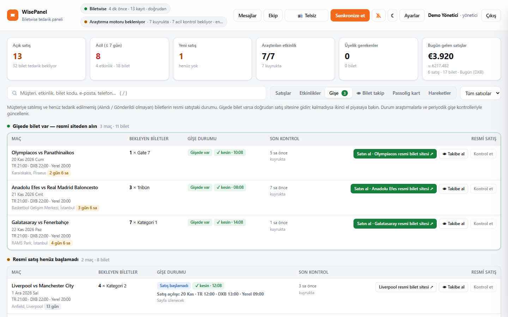
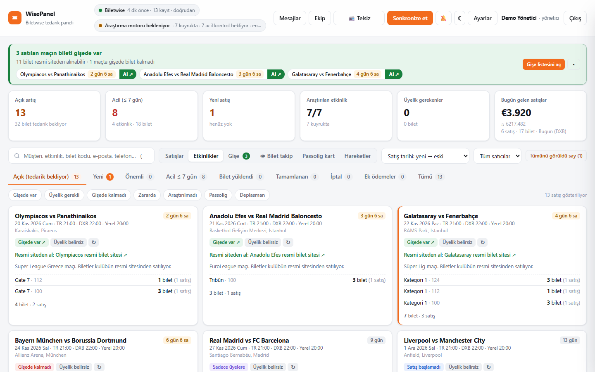
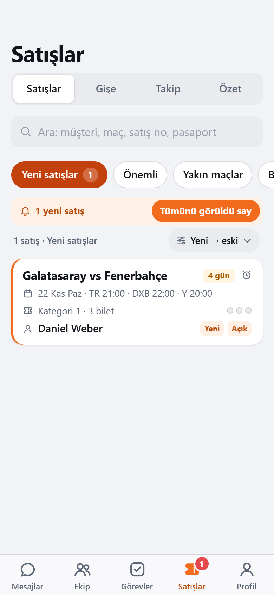
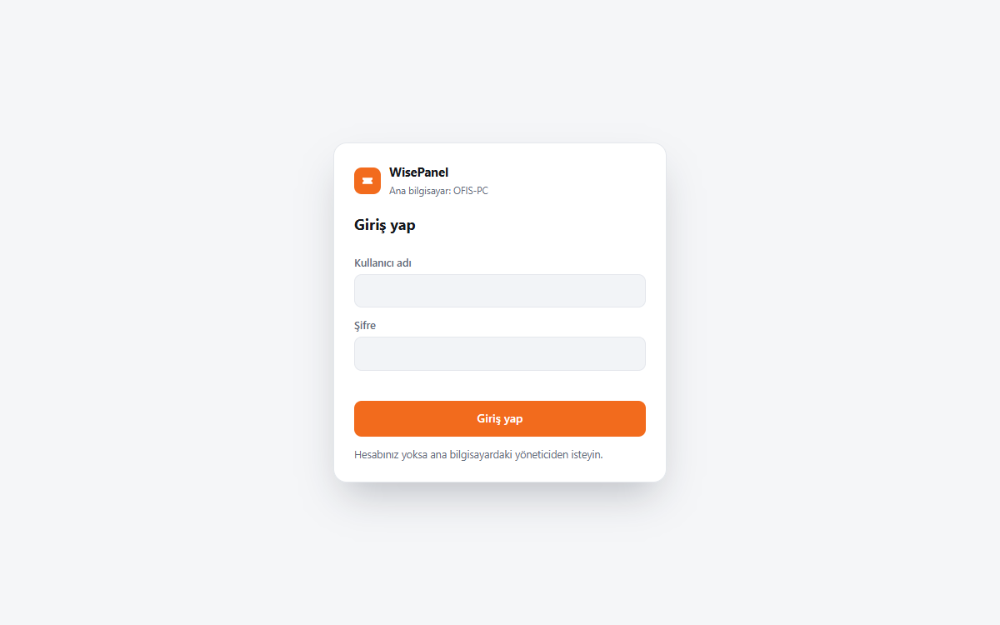

# WisePanel — İndirme ve Güncellemeler

Biletwise satışları için tedarik, gişe takibi ve müşteri mesajları paneli.

- **İndir:** [Son sürüm (Releases)](https://github.com/RoyalFlushTRx/WisePanel-Indir/releases/latest)
- **Neler değişti:** [GUNCELLEMELER.md](GUNCELLEMELER.md)

> Kaynak kod özel depodadır; bu sayfada yalnız kurulum dosyaları, kurulum rehberi ve güncelleme notları bulunur.

## Ekran görüntüleri

> Görüntülerdeki müşteriler, satış numaraları ve fiyatlar örnek (sahte) veridir.

**Satışlar** — her satışın müşterisi, kategorisi, gişe durumu ve tedarik takibi tek tabloda:



**Gişe** — satılan maçların resmi satış durumu: gişede var / üyelere / satış başlamadı (açılış tarihi ve saatiyle) / tükendi:



**Etkinlikler** — maç bazında toplam ihtiyaç ve resmi satış linki:



<table><tr>
<td width="38%"><b>Telefon uygulaması</b><br></td>
<td><b>Giriş</b> — her kullanıcı kendi hesabıyla girer; internetten girişte iki adımlı doğrulama zorunlu yapılabilir.<br></td>
</tr></table>

## Nasıl çalışır

WisePanel tek bir **ana bilgisayarda** çalışır (sunucu, veriler, Biletwise oturumu orada). Diğer bilgisayarlar — ofiste ya da başka şehirde — ve telefonlar bu ana bilgisayara **bağlanır**.

```
 Uzak çalışan bilgisayarı        Ana bilgisayar (ofis)
 WisePanel uygulaması    ──►     WisePanel sunucusu
 Telefon                 ──►     https://<ana-bilgisayar>.<tailnet>.ts.net
 Ofis ağındaki bilgisayar ──►    http://192.168.x.x:5178
```

## Uzaktaki / diğer bilgisayara kurulum

1. [Son sürüm](https://github.com/RoyalFlushTRx/WisePanel-Indir/releases/latest) sayfasından **`WisePanel-uzak-bilgisayar-kurulum.zip`** dosyasını indirin ve bir klasöre açın.
2. **`uzak-bilgisayar-kurulum.bat`** dosyasına çift tıklayın.
3. Ana bilgisayarın adresini yazın (yöneticiden alın):
   - İnternetten: `https://<ana-bilgisayar>.<tailnet>.ts.net`
   - Aynı ofis ağından: `http://192.168.x.x:5178`
4. Betik uygulamayı indirir, bu adrese bağlanacak şekilde ayarlar ve kurulum sihirbazını açar. Kurulum bitince WisePanel açılır; **size verilen kullanıcı adı ve şifreyle** giriş yapın.

Uzaktaki bilgisayara Tailscale ya da başka bir program kurmak gerekmez. Sonraki sürümler ana bilgisayardan **kendiliğinden** kurulur.

**Elle kurulum (yalnız ofis ağı adresi için):** `WisePanel-Kurulum-<sürüm>.exe` → ilk açılışta **"Ana bilgisayara bağlan (istemci)"** → adres → **Bağlantıyı dene** → **Kaydet ve aç**. İnternet (`https://…`) adresi için yukarıdaki betiği kullanın: 2.1.6 sürümünde elle yazılan https adresine yanlışlıkla 5178 portu ekleniyor.

## Telefon

Telefonun tarayıcısında ana bilgisayarın `https://…ts.net` adresini açıp giriş yapın → **Ana ekrana ekle** (iPhone: Safari → Paylaş → Ana Ekrana Ekle). Uygulamayı ana ekrandan açıp **Ayarlar → Bildirimler → "Bu cihazda bildirimleri aç"**.

## Ana bilgisayar

Ana bilgisayar kurulumu (sunucu, Chrome eklentisi, Tailscale) kaynak koduyla birlikte yapılır; özel depodaki rehbere bakın ya da yöneticiyle iletişime geçin.

## Sorun giderme

- **"Adres yanıt vermiyor":** ana bilgisayar açık mı, WisePanel çalışıyor mu? İnternet adresi için ana bilgisayarda Tailscale bağlı olmalı.
- **Bağlanıyor ama giriş olmuyor:** kullanıcı adınızı / şifrenizi yöneticiye sıfırlatın. İki adımlı doğrulama zorunluysa önce telefonunuza doğrulayıcı uygulama kurun.
- **Bildirim gelmiyor:** uygulamada masaüstü bildirimlerinin açık olduğunu, Windows'ta "Odak / Rahatsız etmeyin" modunun kapalı olduğunu kontrol edin.
